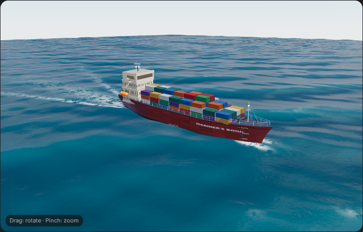
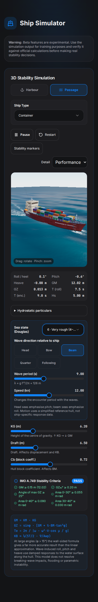
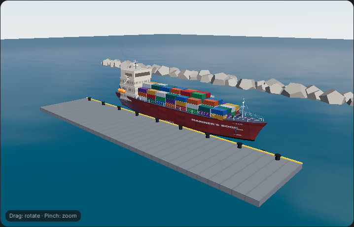

# Directional ocean and coupled vessel motion

The beta simulator at `/beta/ship-simulator` draws an irregular sea and drives roll, pitch and heave from the same surface. Harbour/Passage, all five ship types, wave controls, stability inputs, optional markers and the separate calculations view remain available.

## Behaviour

- Twelve directional components replace three repeating waves. Amplitudes are normalised to `Hs = 4√m₀`; deep-water dispersion and a steepness limit keep period/height meaningful. Head seas propagate toward the bow and agree with the encounter-period calculation.
- One fixed 120 Hz clock drives GPU phases and CPU dynamics. Speed, direction and period interpolate without phase resets. Normal 15–120 fps rendering produces identical motion. Very slow frames have bounded catch-up; suspended tabs discard their time gap.
- The hull sampler inverts horizontal Gerstner displacement and uses nine weighted waterplane stations at 30 Hz, with early convergence of the inverse solve. Damped roll, pitch and heave follow the actual visible water rather than an unrelated sine animation. No artificial calm ellipse surrounds the vessel.
- Analytic normals (interpolated in the lighter tiers), independently moving ripple scales, Fresnel reflections, compression-based crest foam and speed-dependent bow/Kelvin/propeller foam replace flat overlays. Foam is shaded on the displaced water; the hull is correctly occluded below the surface. Assets remain offline capable.
- Pause freezes water, vessel, wake, ensign and exhaust. Restart clears the response. Reduced-motion users start paused; hidden/offscreen views stop animating. Performance/Balanced/High adjusts mesh density, pixel ratio and shading cost. Phones start in Performance; Performance and Balanced use a 30 Hz demand-render timer without shadows. See [mobile performance and motion validation](mobile-performance.md). Readouts sit below the canvas on mobile and markers can be enabled.
- The beta ship has no constant wind/intrinsic list: sea state drives free roll/pitch/heave around upright. The Wind / Roll Moment slider has been removed. Manual heel/trim remains in the separate calculation view.
- Slider names reach the focusable thumb for keyboard/screen-reader use.

## Validation

```sh
npm run test:seakeeping
npm run typecheck
npm run lint
npm run build:native
npm run check:native-build
npx playwright install chromium
npm run check:ocean-ui
```

The browser check renders the real beta page in a temporary local fixture and blocks external requests. It covers animation, pixel-exact pause, quality changes, restart/resume, all vessel types, calm seas, harbour, 375/320 px layouts, reduced motion and the calculations component. It does not test authentication/entitlements. The fixture is removed and never shipped.

`PLAYWRIGHT_CHROMIUM_EXECUTABLE_PATH` selects an installed Chromium. `PLAYWRIGHT_SINGLE_PROCESS=1` supports restricted execution environments. Screenshots go to `tmp/ocean-ui`, or `OCEAN_SCREENSHOT_DIR` when set.

Verified on this branch: 19 seakeeping tests passed; TypeScript passed; ESLint passed with one existing `NewsReaderDialog.tsx` fast-refresh warning; native production build and budget passed (827 JS files, 17.87 MiB). The browser suite passed every listed flow with no React/GLSL/WebGL errors, including pixel-identical paused frames. Screenshots below come from that run.

## Limits

This is a visual training model, not CFD or a ship-specific RAO solution. Vessel choices change appearance but retain the existing 190 m reference hull/hydrostatics and vertical draft scale. Breaking-wave overturning, spray particles, slamming, flooding, moorings and parametric instability are not solved. Resonance notices indicate period proximity only. Impossible short-period/high-wave combinations are limited and the UI reports the resulting spectral Hs.

Physical iOS/Android frame rates, heat and battery use still need device testing; browser validation checks rendering and phone-sized layouts. High detail costs more GPU time.

References: [NVIDIA GPU Gems](https://developer.nvidia.com/gpugems/gpugems/part-i-natural-effects/chapter-1-effective-water-simulation-physical-models) (Gerstner derivatives and nonfolding condition), [Three.js Material](https://threejs.org/docs/pages/Material.html), [MeshPhysicalMaterial](https://threejs.org/docs/pages/MeshPhysicalMaterial.html).

## Screenshots






