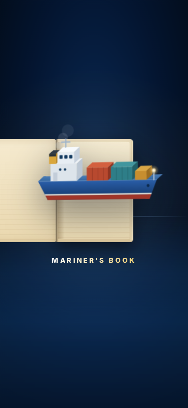
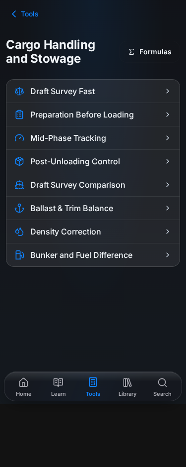
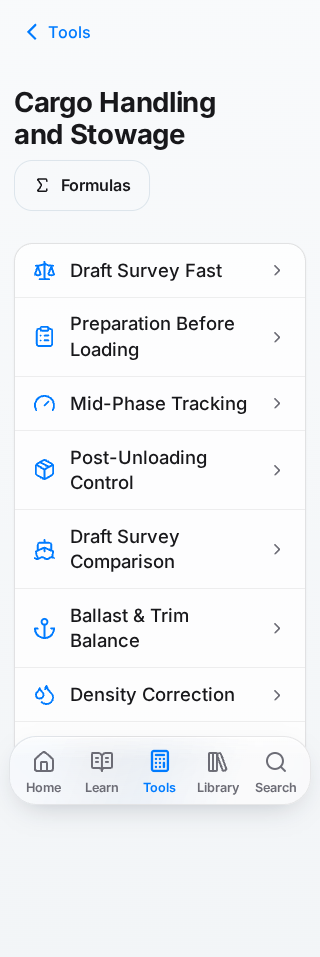
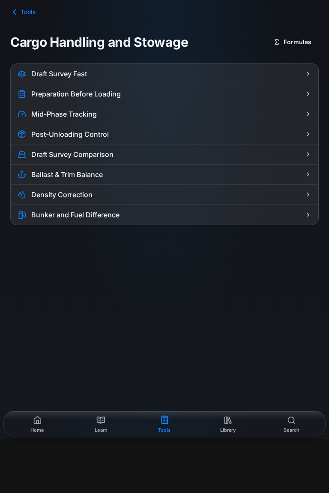

# Legacy pages and launch cleanup

The reported Cargo screen used the retired oversized card shell. The splash was capped by `100svh`, so navigation could show below it when the visible viewport grew. Working content is retained while obsolete shells and duplicate screens are removed.

## Individual inventory

41 page implementations were inspected and changed:

| Page | Route | Finding | Resolution |
| --- | --- | --- | --- |
| [Ballast.tsx](../../src/pages/Ballast.tsx) | `/ballast` | Separate oversized gradient heading and layout | Shared MobileLayout and CalculationPage; calculator retained. |
| [BetaPscChecklist.tsx](../../src/pages/BetaPscChecklist.tsx) | `/beta/psc-checklist` | Duplicate page-owned glow background | Backdrop removed; existing interactions retained. |
| [BridgeDeviceDetail.tsx](../../src/pages/BridgeDeviceDetail.tsx) | `/bridge/:deviceId` | Decorative hero heading, icon tile or glow | Shared PageHeader and semantic colors; content/actions retained. |
| [CalculationSectionPage.tsx](../../src/pages/CalculationSectionPage.tsx) | `/calculations/:categoryId/:sectionId` | Generic placeholder section screen | Validated redirects to working modules, preserving query/hash. |
| [CargoCalculations.tsx](../../src/pages/CargoCalculations.tsx) | `/cargo/calculations` | Oversized card index, repeated heading and nested controls | Compact grouped rows; destinations and formula links retained. |
| [CargoTopicsPage.tsx](../../src/pages/CargoTopicsPage.tsx) | `/lessons/cargo/reference` | Decorative shell and fixed-height nested index scroll | Shared heading and document scrolling; article dialogs and content retained. |
| [CrewRoleDetail.tsx](../../src/pages/CrewRoleDetail.tsx) | `/crew/:roleSlug` | Decorative hero heading, icon tile or glow | Shared PageHeader and semantic colors; content/actions retained. |
| [DetailedMeteorology.tsx](../../src/pages/DetailedMeteorology.tsx) | `/navigation/meteorology; /meteorology/topics` | Decorative hero heading, icon tile or glow | Shared PageHeader and semantic colors; content/actions retained. |
| [EconomicsTopicsPage.tsx](../../src/pages/EconomicsTopicsPage.tsx) | `/lessons/economics/reference` | Decorative shell and fixed-height nested index scroll | Shared heading and document scrolling; article dialogs and content retained. |
| [EmissionCalculationsPage.tsx](../../src/pages/EmissionCalculationsPage.tsx) | `/emissions; /environment/calculations` | Retired CalculationGridScreen shell | Shared CalculationPage; existing calculation components retained. |
| [EmissionFormulas.tsx](../../src/pages/EmissionFormulas.tsx) | `/environment/formulas` | Decorative hero heading, icon tile or glow | Shared PageHeader and semantic colors; content/actions retained. |
| [EmissionQuiz.tsx](../../src/pages/EmissionQuiz.tsx) | `/environment/quiz` | Decorative hero heading, icon tile or glow | Shared PageHeader and semantic colors; content/actions retained. |
| `EmptyPage.tsx` (deleted) | `/empty-page` | Duplicate Home widgets | Deleted; old URL redirects to current Home. |
| [EnvironmentTopicsPage.tsx](../../src/pages/EnvironmentTopicsPage.tsx) | `/lessons/environment/reference` | Decorative shell and fixed-height nested index scroll | Shared heading and document scrolling; article dialogs and content retained. |
| [FluidMechanicsTopicsPage.tsx](../../src/pages/FluidMechanicsTopicsPage.tsx) | `Retained reference component (no active standalone route)` | Decorative shell and fixed-height nested index scroll | Shared heading and document scrolling; article dialogs and content retained. |
| [MachineCalculationsPage.tsx](../../src/pages/MachineCalculationsPage.tsx) | `/machine/calculations; /machine-calculations` | Retired CalculationGridScreen shell | Shared CalculationPage; existing calculation components retained. |
| [MachineFormulas.tsx](../../src/pages/MachineFormulas.tsx) | `/machine/formulas` | Decorative hero heading, icon tile or glow | Shared PageHeader and semantic colors; content/actions retained. |
| [MeteorologyFormulas.tsx](../../src/pages/MeteorologyFormulas.tsx) | `/meteorology/formulas` | Decorative hero heading, icon tile or glow | Shared PageHeader and semantic colors; content/actions retained. |
| [MusterListPage.tsx](../../src/pages/MusterListPage.tsx) | `/crew/muster-list` | Decorative hero heading, icon tile or glow | Shared PageHeader and semantic colors; content/actions retained. |
| [Navigation.tsx](../../src/pages/Navigation.tsx) | `/navigation` | Oversized card index, repeated heading and nested controls | Compact grouped rows; destinations and formula links retained. |
| [ProPage.tsx](../../src/pages/ProPage.tsx) | `/pro` | Decorative hero heading, icon tile or glow | Shared PageHeader and semantic colors; content/actions retained. |
| [RegulationDetailPage.tsx](../../src/pages/RegulationDetailPage.tsx) | `/regulations/:slug` | Decorative hero heading, icon tile or glow | Shared PageHeader and semantic colors; content/actions retained. |
| [SOLASCertificates.tsx](../../src/pages/SOLASCertificates.tsx) | `/solas/certificates` | Decorative hero heading, icon tile or glow | Shared PageHeader and semantic colors; content/actions retained. |
| [SOLASRegulations.tsx](../../src/pages/SOLASRegulations.tsx) | `/solas/regulations` | Decorative hero heading, icon tile or glow | Shared PageHeader and semantic colors; content/actions retained. |
| [SOLASSafetyEquipment.tsx](../../src/pages/SOLASSafetyEquipment.tsx) | `/solas/safety-equipment` | Decorative hero heading, icon tile or glow | Shared PageHeader and semantic colors; content/actions retained. |
| [SOLASShipRequirements.tsx](../../src/pages/SOLASShipRequirements.tsx) | `/solas/ship-requirements` | Decorative hero heading, icon tile or glow | Shared PageHeader and semantic colors; content/actions retained. |
| [SafetyCalculations.tsx](../../src/pages/SafetyCalculations.tsx) | `/safety` | Retired CalculationGridScreen shell | Shared CalculationPage; existing calculation components retained. |
| [SafetyFormulas.tsx](../../src/pages/SafetyFormulas.tsx) | `/safety/formulas` | Decorative hero heading, icon tile or glow | Shared PageHeader and semantic colors; content/actions retained. |
| [SafetyTopicsPage.tsx](../../src/pages/SafetyTopicsPage.tsx) | `/lessons/safety/reference` | Decorative shell and fixed-height nested index scroll | Shared heading and document scrolling; article dialogs and content retained. |
| [SeamanshipCalculations.tsx](../../src/pages/SeamanshipCalculations.tsx) | `/seamanship/calculations` | Oversized card index, repeated heading and nested controls | Compact grouped rows; destinations and formula links retained. |
| [SeamanshipFormulas.tsx](../../src/pages/SeamanshipFormulas.tsx) | `/seamanship/formulas` | Decorative hero heading, icon tile or glow | Shared PageHeader and semantic colors; content/actions retained. |
| [SeamanshipTopicsPage.tsx](../../src/pages/SeamanshipTopicsPage.tsx) | `/lessons/seamanship/reference` | Decorative shell and fixed-height nested index scroll | Shared heading and document scrolling; article dialogs and content retained. |
| [ShipTaskDetailPage.tsx](../../src/pages/ShipTaskDetailPage.tsx) | `/ship-tasks/:taskSlug` | Duplicate page-owned glow background | Backdrop removed; existing interactions retained. |
| [SpecialShipCalculations.tsx](../../src/pages/SpecialShipCalculations.tsx) | `/special-ships` | Retired CalculationGridScreen shell | Shared CalculationPage; existing calculation components retained. |
| [StabilityCalculations.tsx](../../src/pages/StabilityCalculations.tsx) | `/stability/calculations` | Retired CalculationGridScreen shell | Shared CalculationPage; existing calculation components retained. |
| [StabilityShearingBending.tsx](../../src/pages/StabilityShearingBending.tsx) | `/stability/shearing-bending` | Retired CalculationGridScreen shell | Shared CalculationPage; existing calculation components retained. |
| [StabilityTopicsPage.tsx](../../src/pages/StabilityTopicsPage.tsx) | `/lessons/stability/reference` | Decorative shell and fixed-height nested index scroll | Shared heading and document scrolling; article dialogs and content retained. |
| [StructuralCalculations.tsx](../../src/pages/StructuralCalculations.tsx) | `/structural` | Retired CalculationGridScreen shell | Shared CalculationPage; existing calculation components retained. |
| [TankCalculations.tsx](../../src/pages/TankCalculations.tsx) | `/tank` | Retired CalculationGridScreen shell | Shared CalculationPage; existing calculation components retained. |
| [DeckCurriculumCoursePage.tsx](../../src/pages/curriculum/DeckCurriculumCoursePage.tsx) | `/lessons/:categoryId/topics` | Decorative hero heading, icon tile or glow | Shared PageHeader and semantic colors; content/actions retained. |
| [MachineCurriculumCoursePage.tsx](../../src/pages/curriculum/MachineCurriculumCoursePage.tsx) | `/machine/:topicSlug/topics` | Decorative hero heading, icon tile or glow | Shared PageHeader and semantic colors; content/actions retained. |

## Shared behavior

- `calculation-grid.tsx` is deleted. Its callers use the current inset-grouped pattern. Cargo retains all 8 tools, Navigation 25 and Stability 6.
- Formula metadata and sources remain in expandable details outside navigation links; anchors no longer contain other anchors/buttons.
- PageHeader wraps on narrow screens and at larger font settings. Reference indexes use document scrolling; article dialogs retain their own scrolling.
- Current Home widgets, Library, Saved, study activity, authentication, Pro gates and calculation implementations remain intact. Simulator and Moon Phases keep their intentional immersive visuals.
- `/empty-page` replaces history with Home. Generic category sections resolve to real deck/engine modules. Invalid sections return to Tools.
- Splash covers the whole viewport with an opaque background. The mounted root remains hidden, inert and excluded from accessibility until dismissal finishes. Tap skip, reduced motion, diagnostic and watchdog paths release it correctly.

## Verification

- Typecheck and lint passed (one pre-existing Fast Refresh warning in `NewsReaderDialog.tsx`).
- Legacy guard scans 155 page files. Design-system, UX, library interface and SVG text checks passed.
- Native boot, secure storage, navigation UI, core copy, study activity and library-resource-link tests passed. Watchdog regression covers failed boot and stalled dismissal after mount.
- Native production build and size budget passed: 827 JS files, 17.83 MiB total, 1466.4 KiB largest chunk.
- Earlier production smoke inspection reached headings on 38 affected routes and exercised reference accordions. The committed `check:launch-ui` passed against the native production preview with zero browser runtime errors. It verifies launch isolation, viewport growth/orientation, Cargo links and app back, light/dark mobile/tablet layout, large-text last-row reachability, Navigation/Stability rows, formula details and five legacy redirects.
- Curriculum hierarchy preserved 25 courses, 154 modules, 807 topics, 2110 authored checks and 4353 bank questions. Topic schema (400 entries) and rule integration passed; existing missing MeteorologyTopicsPage warning remains.
- `i18n:verify` passed extraction, terminology and translation-barrier tests, then stopped at strict coverage: 17 existing source keys are missing from all 24 dictionaries. Each key was confirmed on base `bdc4818`; no dictionaries changed. Separate terminology/sense audits passed with zero findings. Paragraph (7265/7265), learning (2717) and terminology-override (214) pack checks passed.

Run the focused browser check after `npm run build:native`:

```sh
npm run check:launch-ui
```

Set `PLAYWRIGHT_CHROMIUM_EXECUTABLE_PATH` only when using a local Chromium executable instead of Playwright's installed browser. The test uses a synthetic session and intercepts external traffic; it never signs in or writes to a backend. Physical iPhone/WKWebView verification remains a device review step. No version bump, deployment, database change or merge is included.

## Screenshots

| Launch, 375 px | Cargo, 375 px / dark |
| --- | --- |
|  |  |

| Cargo, 320 px / large text / light | Cargo, 768 px |
| --- | --- |
|  |  |
